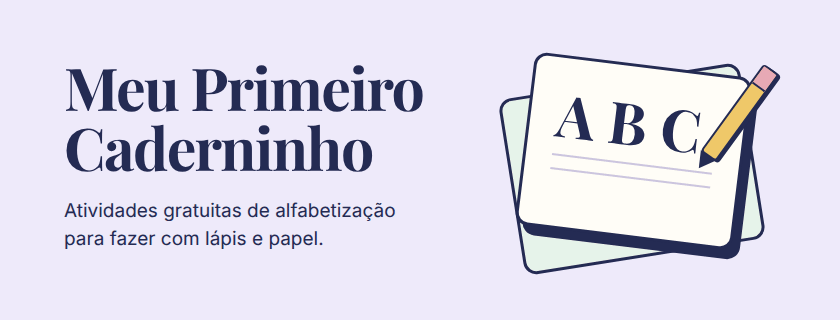
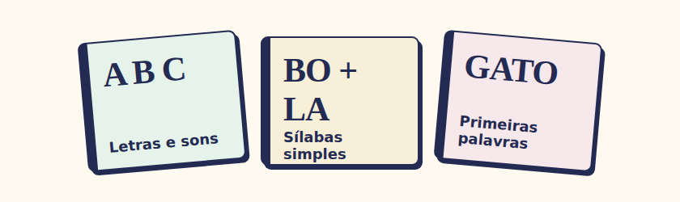
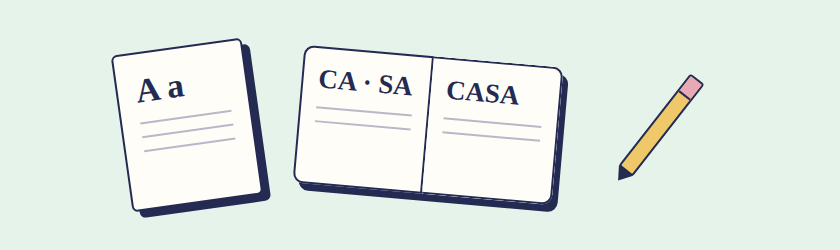

# Meu Primeiro Caderninho



Um lápis e as últimas folhas de um caderno já dão pra começar.

[Baixar os PDFs](#atividades-de-alfabetização-para-imprimir) · [Minha história](#minha-história) · [Como contribuir](CONTRIBUTING.md) · [Apoio de empresas](#apoio-de-empresas) · [Roteiro do projeto](TODO.md)

> **Precisamos de ajuda humana e de tokens para tocar o projeto.** Educadores, famílias e pessoas desenvolvedoras podem ajudar com revisão, testes e manutenção. Créditos de API e tokens de ferramentas de desenvolvimento ajudam a cobrir o trabalho de preparação e verificação do material. A revisão pedagógica é feita por pessoas e está aberta a contribuições.

O Meu Primeiro Caderninho é um projeto de código aberto que reúne atividades gratuitas de alfabetização em português do Brasil. É para famílias que querem praticar a leitura em casa, inclusive quando só têm um celular simples, internet limitada ou nenhum material impresso.

Cada atividade tem uma página leve para abrir no celular, instruções curtas para quem acompanha a criança e uma versão para imprimir em preto e branco. Os caderninhos completos podem ser baixados em PDF para usar sem internet. Se faltar impressora, dá para copiar o exercício no caderno.

## Atividades de alfabetização para imprimir



São 12 atividades gratuitas em português do Brasil, quatro por caderninho. Cada PDF tem folhas A4 em preto e branco e um gabarito no final. Baixe direto do repositório para usar sem internet.

| Caderninho | O que a criança pratica | Download |
| --- | --- | --- |
| Letras e sons | Reconhecer letras, ouvir o som inicial e comparar palavras como PATO e PIPA. | [PDF de letras e sons](public/caderninhos/letras-e-sons.pdf) |
| Sílabas simples | Juntar sílabas, completar a parte que falta e colocar as sílabas na ordem. | [PDF de sílabas simples](public/caderninhos/silabas-simples.pdf) |
| Primeiras palavras | Ler palavras curtas, completar frases e desenhar o que leu. | [PDF de primeiras palavras](public/caderninhos/primeiras-palavras.pdf) |

### Como praticar a leitura em casa

Abra uma atividade no celular ou imprima só a folha que pretende usar. Separe lápis e caderno, leia a instrução com a criança e dê tempo para ela tentar. Consulte as orientações para o adulto e use o gabarito para conversar sobre as respostas.

- **Atividades de alfabetização sem impressora.** Mostre as palavras no celular ou copie as perguntas no caderno. Por exemplo, fale PATO, PANO e BOLA e peça para a criança apontar as duas palavras que começam com o mesmo som.
- **Atividades para turma, biblioteca ou reforço.** Baixe o caderninho, imprima em A4 e mantenha os créditos ao distribuir ou adaptar as folhas.
- **Atividades para usar offline.** Salve os PDFs quando tiver conexão e abra no leitor de PDF do celular quando precisar.

## Minha história


Sou de Morada Nova, no interior do Ceará. Minha história começa no sítio, longe da tecnologia. Foi ali que comecei a estudar. Minha irmã aprendeu a ler antes de mim e me ajudava em casa. Praticar com ela me ajudou muito a destravar na escola e a ganhar confiança na leitura. Essa lembrança está na origem do Meu Primeiro Caderninho. Quero que outras famílias tenham atividades simples para praticar juntas, mesmo quando só têm lápis e caderno.

Na adolescência, fui morar no centro da cidade. Conheci as lan houses, entrei no universo dos games e quis entender como eles funcionavam. Comecei a estudar programação por hobby, errando, testando e pesquisando.

Quando minha irmã começou a vender trufas, fiz a primeira logo dela no Word. Ficou horrível, mas foi o que me despertou para o design. Um amigo me deu direção para estudar design gráfico, e criei coragem para procurar meu primeiro serviço. Meu primeiro cliente era fisioterapeuta, tinha estudado marketing no TCC e depois virou meu sócio. Quando ele e a esposa adquiriram uma franquia de estética, vi de perto a oportunidade de trabalhar com marketing para clínicas. Aprendi no dia a dia, ao lado de profissionais e acompanhando casos reais.

Com o tempo, comecei a ensinar vendas. Queria entender o que estava ensinando, então fui estudar tomada de decisão, vieses cognitivos, objeções, ética, filosofia e comportamento humano. Passei a capacitar equipes com base nesses estudos e nos dados do trabalho. Mais tarde, acompanhei o desenvolvimento de um projeto de conteúdo científico em fisioterapia dermatofuncional, o que reforçou meu interesse por pesquisa e por comunicar o que aprendo.

Também comecei a preparar um e-book sobre a ciência por trás das vendas e de como lidar com objeções. Tecnologia, marketing, ciência e comunicação continuam fazendo parte do meu trabalho. Com este projeto, volto a uma experiência que veio antes de tudo isso: aprender a ler com a ajuda de alguém em casa.

### Educação no Ceará

Entre 2023 e 2025, o Ideb dos anos iniciais do Ensino Fundamental na rede pública do Ceará passou de 6,5 para 6,8. [Governo do Ceará](https://www.ce.gov.br/2026/10/05/ideb-2025-indices-do-ceara-continuam-subindo-em-todos-os-niveis-da-educacao-basica/) · [Inep](https://www.gov.br/inep/pt-br/centrais-de-conteudo/noticias/ideb/ideb-avanca-em-todas-as-etapas-da-educacao-basica-no-ceara)

## Rodar localmente

Use o Node.js indicado em `.nvmrc` e o npm.

```sh
nvm use
npm ci
npm run dev
```

Abra o endereço mostrado pelo Astro, com o prefixo `/meu-primeiro-caderninho/`. Para validar e conferir a saída estática:

```sh
npm run check
npm run build
npm run preview
```

O site usa Astro, Markdown e CSS puro. Após a instalação, o build usa os arquivos locais e gera HTML, CSS, PDFs e sitemap em `dist/`. O site funciona sem banco de dados, cadastro ou API.

## Adicionar ou revisar uma atividade

1. Crie ou edite um Markdown em `src/content/atividades/`. Use um nome de arquivo curto, com letras minúsculas sem acentos e hífens. Esse nome forma o endereço público da atividade.
2. Preencha `titulo`, `descricao`, `caderno`, `habilidade`, `ordem`, `crianca` e `adulto`. Inclua `respostas` quando houver solução objetiva. Use uma ordem inteira positiva e única dentro do caderninho.
3. Escreva o exercício no corpo do Markdown. Para deixar espaço na folha, use `<span class="linha"></span>` ou, para desenho, `<span class="espaco-desenho"></span>`.
4. Rode a validação, confira a atividade no celular e atualize os PDFs.

### Atualizar os PDFs

Com Chromium ou Chromium Headless Shell instalado, rode `npm run pdfs`. Se o executável tiver outro nome ou estiver fora do PATH, indique o caminho:

```sh
CHROMIUM_BIN=/caminho/para/chromium npm run pdfs
```

O comando compila o site, abre as três páginas dos caderninhos em um servidor local temporário e usa o Chromium para imprimir em A4. Os PDFs atualizados ficam em `public/caderninhos/` e entram no build final. Confira a paginação, o espaço para responder e o gabarito antes de incluir os PDFs na alteração de conteúdo.

## SEO e descoberta do conteúdo

Cada atividade tem URL estável, título descritivo, descrição própria e link para seu caderninho. O HTML sai em português do Brasil, com URL canônica e sitemap gerados no build. Use títulos que descrevam o exercício, como “Complete com a sílaba que falta”, e textos de link que indiquem o material de destino.

Depois de publicar, confira as canônicas e os PDFs no domínio público e envie o sitemap pelo Google Search Console. Ao divulgar uma folha, compartilhe também a página da atividade, onde ficam as instruções e a orientação ao adulto. [Guia de SEO do Google](https://developers.google.com/search/docs/fundamentals/seo-starter-guide).

## Publicar no GitHub Pages

O destino padrão é `https://devgiordane.github.io/meu-primeiro-caderninho/`. Depois de revisar as alterações, selecione **GitHub Actions** em **Settings → Pages → Build and deployment → Source**. O workflow valida pull requests e publica a partir de `main`. Também pode ser executado manualmente em `main`. [Documentação do GitHub Pages](https://docs.github.com/en/pages/getting-started-with-github-pages/using-custom-workflows-with-github-pages).

Para publicar na raiz de um domínio, use `PAGES_BASE=/` e `PAGES_SITE=https://seu-dominio.example` no build e configure os mesmos valores no ambiente do workflow. Para outro repositório de projeto, defina `PAGES_BASE=/nome-do-repositorio` e `PAGES_SITE` como a origem pública, sem o nome do repositório. Use os mesmos valores ao rodar o preview.

## Ajude mais crianças brasileiras a praticar a leitura

- Educadores e famílias podem sugerir exercícios, apontar instruções confusas e ajudar na revisão.
- Desenvolvedores e designers podem melhorar a leitura no celular, a acessibilidade e a impressão.
- Escolas e bibliotecas podem compartilhar os caderninhos com as famílias.
- Empresas podem apoiar com acesso a ferramentas de desenvolvimento ou com impressão de caderninhos para distribuição local.

Para sugerir uma atividade, relatar um problema ou propor apoio, [abra uma issue](https://github.com/devgiordane/meu-primeiro-caderninho/issues). Se já tiver uma contribuição pronta, [envie um pull request](https://github.com/devgiordane/meu-primeiro-caderninho/pulls).

## Apoio de empresas



Empresas, editoras, gráficas e equipes de tecnologia podem ajudar com:

- **Horas de trabalho voluntário.** Revisão pedagógica, acessibilidade, design, testes em celulares simples ou manutenção.
- **Créditos e tokens.** Créditos de API, cotas de ferramentas de desenvolvimento ou infraestrutura de testes para preparar e verificar novas atividades.
- **Impressão e distribuição.** Papel, impressão em preto e branco e entrega de caderninhos a bibliotecas, escolas e projetos comunitários.
- **Divulgação.** Compartilhamento do catálogo em redes de educação e canais internos de voluntariado.

[Proponha uma colaboração em uma issue](https://github.com/devgiordane/meu-primeiro-caderninho/issues/new?title=Proposta%20de%20apoio). Informe o tipo de apoio, a disponibilidade e um canal público de contato. Combine a concessão de créditos pelo canal oficial do fornecedor e mantenha chaves e tokens de acesso fora das issues. Apoios confirmados podem receber um agradecimento público com autorização da empresa.

Para contato direto, propostas de parceria, doações ou presentes para o projeto, escreva para [devgiordane.mpc@gmail.com](mailto:devgiordane.mpc@gmail.com).

## Próximos passos

O [roteiro de evolução](TODO.md) reúne novas atividades e melhorias de impressão, acessibilidade, publicação e manutenção. Para pegar uma tarefa, siga o [guia de contribuição](CONTRIBUTING.md).

## Licenças

O código usa a [licença MIT](LICENSE). As atividades originais e seus caderninhos em PDF usam a [licença CC BY 4.0](LICENSE-CC-BY-4.0.txt).

Ao compartilhar ou adaptar uma atividade, credite “Meu Primeiro Caderninho — Giordane Oliveira”, inclua o endereço da atividade original, indique as alterações feitas e forneça o link da [licença CC BY 4.0](https://creativecommons.org/licenses/by/4.0/).
